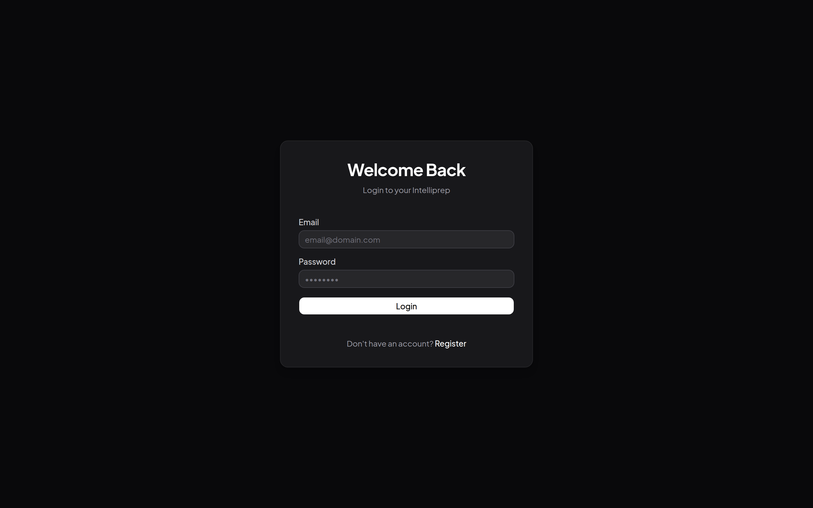
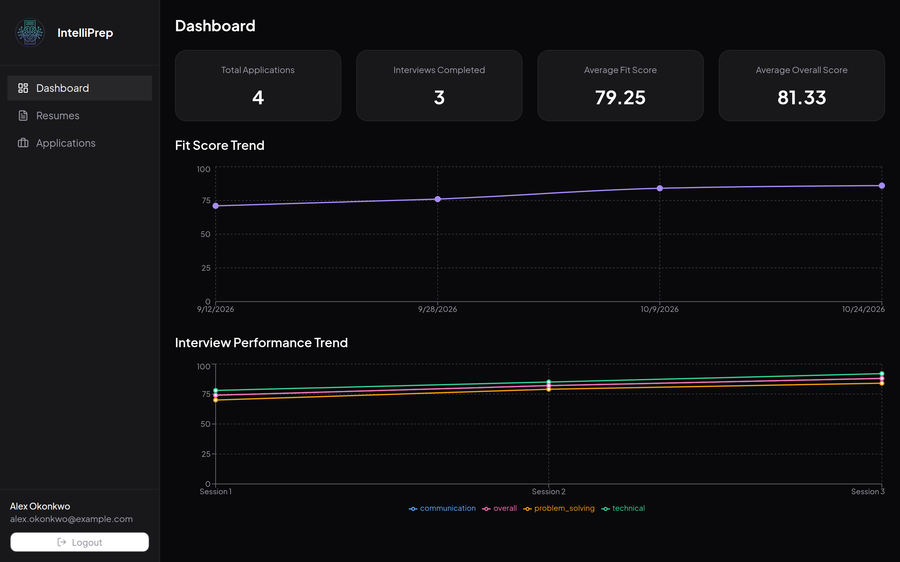
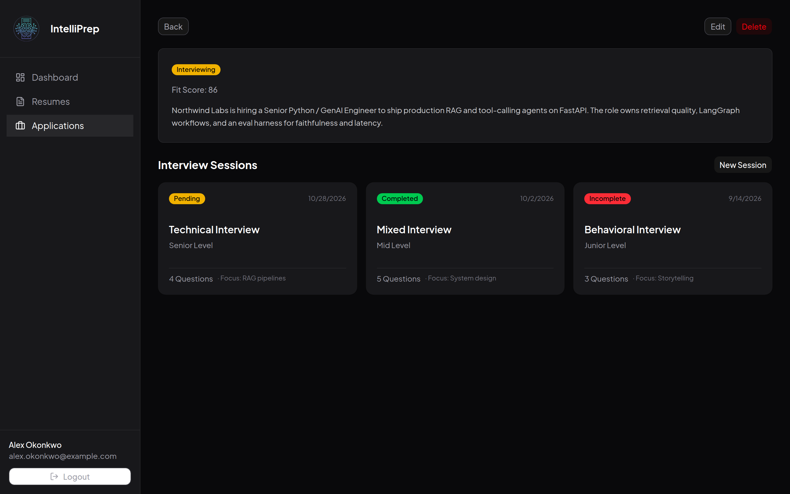
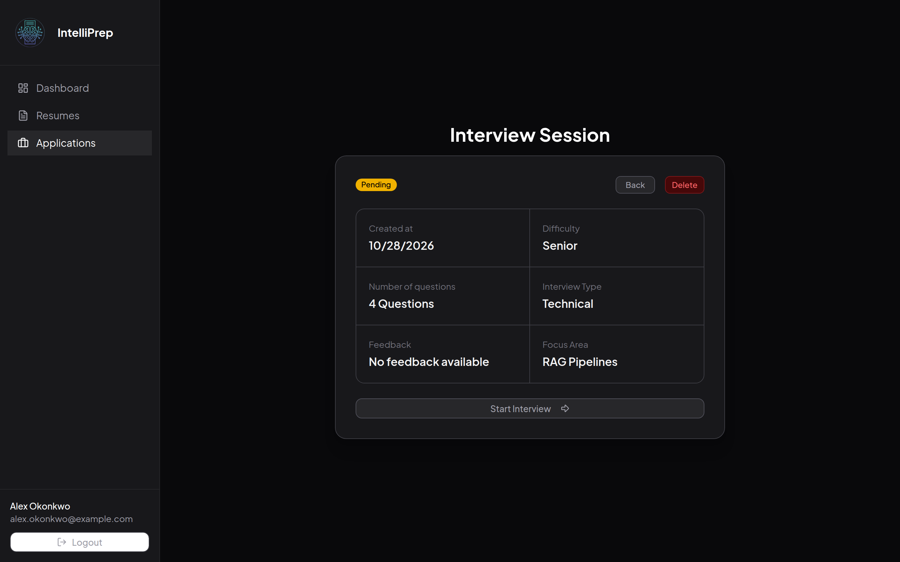
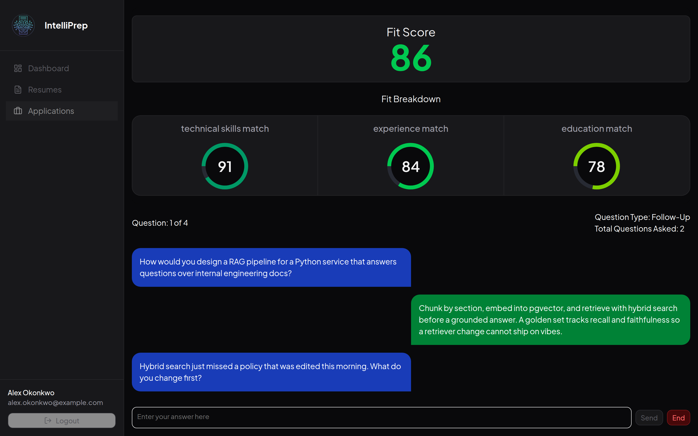
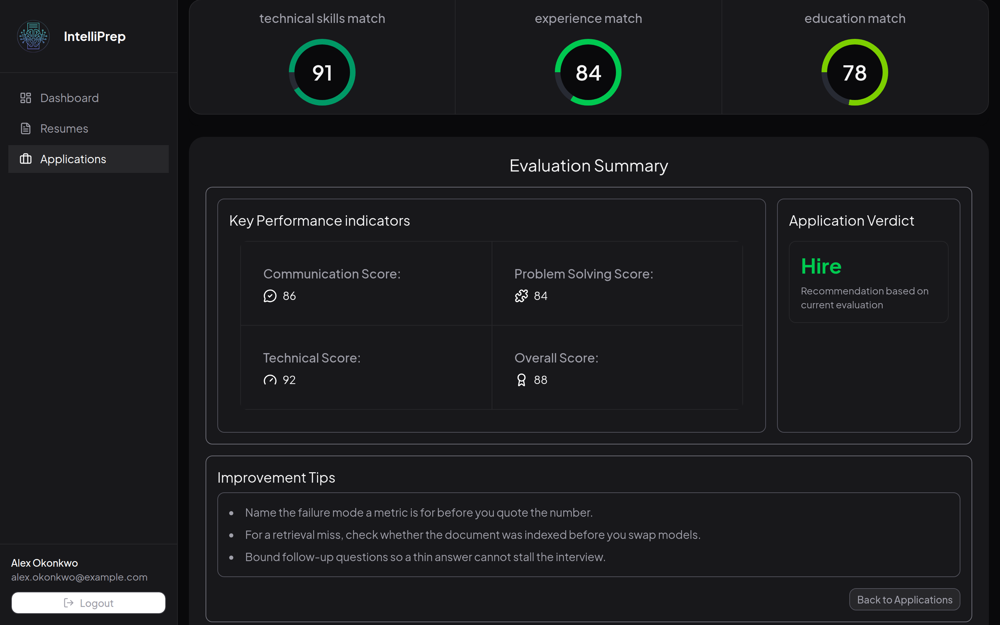
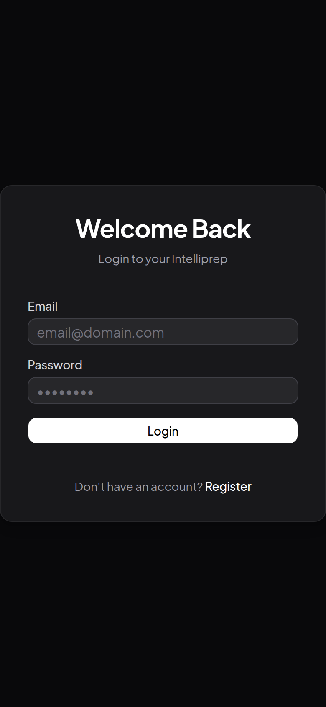

<div align="center">

# IntelliPrep — Frontend

AI-powered mock interview platform. Upload your resume and a job description, get a fit score, and go through a full AI-driven interview with real-time feedback, scores, and a hire/no-hire verdict.

<p>
  
  
  
  
  
  
  
</p>

<sub>Frontend repository · <a href="https://github.com/raosam23/intelli-prep-backend">Backend repository →</a></sub>

</div>

> **Note:** This frontend requires the [IntelliPrep backend](https://github.com/raosam23/intelli-prep-backend) to be running. Clone and start the backend first.

---

## Screenshots

Real screens from this frontend, captured at a 1440×900 viewport (login is also shown at a 390×844 phone width). The Python / GenAI interview is sample data: REST responses and the interview WebSocket are intercepted in the browser, so the images can be regenerated without the backend. See [Refreshing the screenshots](#refreshing-the-screenshots).

**Sign in** — email and password before any interview data is loaded.



**Dashboard** — application counts, fit-score trend, and interview performance after a few completed sessions.



**Application** — the Northwind Labs Python / GenAI role, its fit score, and the interview sessions created for it.



**Start an interview** — a pending senior technical session, focused on RAG pipelines, ready to begin.



**Live interview** — fit breakdown above the first answer and a follow-up question.



**Results** — technical, problem-solving, and communication scores, a hire verdict, and improvement tips.



**Phone** — the login card at a 390px-wide viewport.

<p align="center">
  
</p>

---

## Tech Stack

| Layer            | Technology              |
| ---------------- | ----------------------- |
| Framework        | Next.js 16 (App Router) |
| Language         | TypeScript              |
| Styling          | Tailwind CSS v4         |
| UI Components    | shadcn/ui + Radix UI    |
| State Management | Zustand                 |
| HTTP Client      | Axios                   |
| Charts           | Recharts                |
| Notifications    | Sonner                  |

---

## How It Works

1. **Sign up / Log in** — Create an account or log in to access the platform.
2. **Upload a resume** — Upload a PDF resume. The backend extracts structured data from it.
3. **Create a job application** — Enter the job description for the role you are targeting.
4. **Create an interview session** — Link a resume and a job application to start a session.
5. **Start the interview** — Connects to the backend via WebSocket. The LangGraph AI agent:
    - Parses the resume and job description.
    - Generates a **fit score** and **fit breakdown** (how well your profile matches the role).
    - Asks tailored interview questions one at a time.
    - May ask **follow-up questions** if an answer needs more depth.
6. **Get your results** — After all questions are answered, the AI produces:
    - **Technical**, **problem-solving**, and **communication** scores.
    - A **hire verdict** (`HIRE`, `STRONG_HIRE`, `NO_HIRE`, `STRONG_NO_HIRE`, or `NO_DECISION`).
    - A list of **improvement tips**.
7. **Dashboard** — View an overview of all your interview sessions, fit scores, and performance trends across applications.

You can run multiple interview sessions per job application, swap resumes, create new job applications, and repeat the process freely.

---

## Project Structure

```
app/
├── (auth)/
│   ├── login/          # Login page
│   └── register/       # Registration page
├── (dashboard)/
│   ├── dashboard/      # Analytics & overview dashboard
│   ├── resumes/        # Resume management
│   ├── applications/   # Job application management
│   └── interview/      # Interview session UI (WebSocket)
├── layout.tsx
└── page.tsx
store/                  # Zustand stores (auth, resume, application, interview, analytics)
components/             # Shared UI components
lib/                    # Utilities & API client
types/                  # TypeScript type definitions
```

---

## Installation & Running

### Prerequisites

- Node.js 18+
- The IntelliPrep backend running at `http://localhost:8000` (see [intelli-prep-backend](https://github.com/raosam23/intelli-prep-backend))

### 1. Clone the repository

```bash
git clone <repo-url>
cd frontend
```

### 2. Install dependencies

```bash
npm install
```

### 3. Configure environment variables

Create a `.env.local` file in the `frontend/` directory:

```env
NEXT_PUBLIC_API_URL=http://localhost:8000
NEXT_PUBLIC_WS_URL=ws://localhost:8000
```

### 4. Start the development server

```bash
npm run dev
```

The app will be available at [http://localhost:3000](http://localhost:3000).

---

## Available Scripts

| Command               | Description                                      |
| --------------------- | ------------------------------------------------ |
| `npm run dev`         | Start development server                         |
| `npm run build`       | Build for production                             |
| `npm run start`       | Start the production server                      |
| `npm run lint`        | Run ESLint                                       |
| `npm run screenshots` | Rebuild the app and refresh `docs/screenshots/` |

---

## Environment Variables Reference

| Variable              | Required | Description                                   |
| --------------------- | -------- | --------------------------------------------- |
| `NEXT_PUBLIC_API_URL` | Yes      | Base URL of the IntelliPrep backend REST API  |
| `NEXT_PUBLIC_WS_URL`  | Yes      | Base WebSocket URL of the IntelliPrep backend |

---

## Refreshing the screenshots

[`scripts/capture-screenshots.mjs`](scripts/capture-screenshots.mjs) rebuilds the production app, opens it in headless Chrome, and saves PNGs to `docs/screenshots/`.

Requests to `http://localhost:8000` and the interview WebSocket at `ws://localhost:8000/api/ws/interview/{session_id}` are intercepted in the browser. The mock covers the calls this UI makes: login, the current user, resumes, job applications, interview sessions, dashboard analytics, and the live interview. On the socket the server sends `fit_score`, then `question` messages (including a `followup`), and the client answers with `{ type: "answer", answer }` until a final `evaluation`. Nothing in the application code is stubbed. No Postgres, OpenAI key, or running backend is required.

Google Chrome needs to be installed, and port 3000 needs to be free.

```bash
npm run screenshots
```
